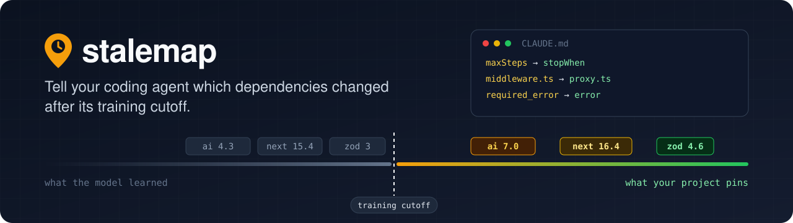
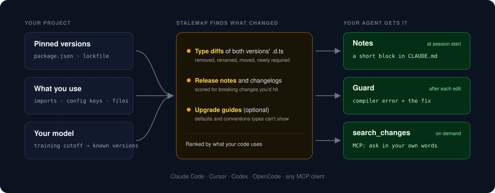
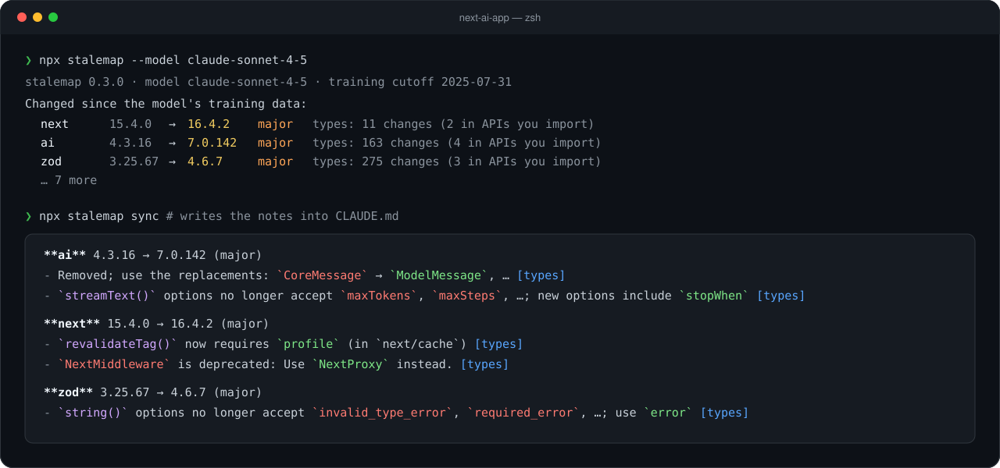
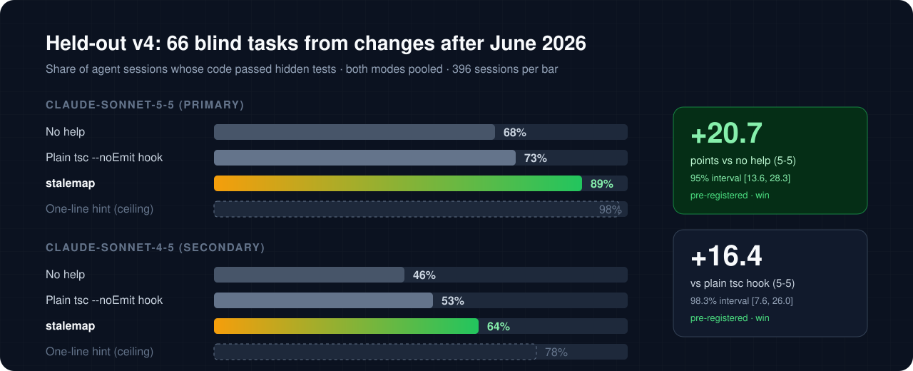

<p align="center">
  
</p>

<p align="center">
  <a href="https://www.npmjs.com/package/stalemap"></a>
  <a href="https://github.com/Umair/stalemap/actions/workflows/ci.yml"></a>
  <a href="LICENSE"></a>
  
  <a href="#claude-code-plugin"></a>
  <a href="#any-mcp-client"></a>
</p>

<p align="center">
  <a href="#install">Install</a> ·
  <a href="#what-the-notes-look-like">Example</a> ·
  <a href="#how-it-works">How it works</a> ·
  <a href="#results">Results</a> ·
  <a href="CHANGELOG.md">Changelog</a>
</p>

Coding agents learn libraries from training data that stops at a cutoff date. When your project pins newer versions, the agent writes code for the old API: `maxSteps` against AI SDK 7, `required_error` against zod 4, `middleware.ts` against Next 16.

stalemap finds the dependencies that changed after your model's training cutoff and tells the agent what changed, in three ways:

- **Notes:** a short, ranked list of changes written into `AGENTS.md` or `CLAUDE.md`, so the agent reads it before it starts.
- **Edit-time guard:** after each edit, the project's own type-check. If the code uses an API that changed after the cutoff, the agent gets the compiler error and the matching note (or the release-note or upgrade-guide section that explains it) right away. It also reports the code that still compiles but uses something that moved.
- **`search_changes`:** an MCP tool the agent can ask in its own words, such as "resolve alias in next.config", to get the matching changes with their sources.

It works for JavaScript and TypeScript projects, with Claude Code, Cursor, Codex, OpenCode or any MCP client.

**In a blind, pre-registered benchmark** of 66 tasks built from changes released after June 2026, `claude-sonnet-5-5` agents passed **89%** of sessions with stalemap, against **68%** with no help and **73%** with a plain `tsc --noEmit` hook after each edit. See [Results](#results).

<p align="center">
  
</p>

## Status

- **npm:** the latest release is [`stalemap` 0.4.0](https://www.npmjs.com/package/stalemap), the build tested in held-out v4. `npx stalemap`, the Claude Code plugin and the GitHub Action all run it. See the [changelog](CHANGELOG.md).
- The project is early, and maintained by one person.

## Install

### Claude Code plugin

```text
/plugin marketplace add Umair/stalemap
/plugin install stalemap@stalemap
```

The plugin adds:

- a SessionStart hook that puts the notes into Claude's context for the session's model (on startup, after `/clear` and after compaction; it writes no files);
- a PostToolUse hook that runs the edit-time guard after each Write or Edit;
- the stalemap MCP server and two skills (`/stalemap:sync` writes the notes block; `upgrade` tells Claude to look up a package's changes before using or upgrading it).

The hooks and the MCP server run `npx -y stalemap@latest`, so they use the latest npm release. Its MCP tools are `search_changes`, `package_changes`, `project_changes` and `check_notes`.

### Command line

```bash
npx stalemap            # preview what changed and the block it would write
npx stalemap sync       # write the block into AGENTS.md or CLAUDE.md
npx stalemap check      # for CI: exit 1 when the block is missing or stale
npx stalemap guard src/**/*.ts   # run the guard by hand
```

The block sits between `<!-- stalemap:start -->` and `<!-- stalemap:end -->`. Text outside it is never touched. Claude Code reads `CLAUDE.md`; if your notes live in `AGENTS.md`, add `@AGENTS.md` to `CLAUDE.md` or pass `--target CLAUDE.md`.

### Other agents: `setup --agent`

```bash
stalemap setup --agent cursor             # or codex, opencode, claude
stalemap setup --agent codex --dry-run    # print the changes, write nothing
```

One command per agent writes the notes, registers the MCP server and installs the guard as the agent's post-edit hook, as project files you can commit. It merges into existing config files, keeps entries it didn't write, and re-running it changes nothing.

One caveat: it hasn't been tried in a real Cursor, Codex or OpenCode install yet. Cursor doesn't pass a `postToolUse` hook's context to the model yet, so setup adds a stop-hook fallback that sends unreported findings as a follow-up message.

### Any MCP client

```json
{ "mcpServers": { "stalemap": { "command": "npx", "args": ["-y", "stalemap@latest", "mcp"] } } }
```

### GitHub Action

```yaml
- uses: Umair/stalemap@main
  with:
    model: claude-opus-5-5          # fail CI when the notes are missing or stale
    # mode: comment                 # or comment on PRs that change dependencies
```

Comment mode needs `permissions: pull-requests: write`. It lists each changed dependency (what the model knows → what's pinned) with its notes, and updates the comment on later pushes.

## What the notes look like

<p align="center">
  
</p>

For a Next.js + AI SDK app and `claude-sonnet-4-5` (cutoff 2025-07-31), excerpt:

```markdown
**ai** 4.3.16 → 7.0.142 (major)
- `CoreMessage` was removed; use `ModelMessage`. [types]
- `convertToCoreMessages` was removed; use `convertToModelMessages`. [types]
- `streamText()` options no longer accept `maxTokens`, `maxSteps`, `toolCallStreaming`, … [types]

**next** 15.4.0 → 16.4.2 (major)
- `revalidateTag()` now requires `profile` (in `next/cache`) [types]
- `NextMiddleware` is deprecated: Use `NextProxy` instead. Middleware has been renamed to Proxy. (in `next/server`) [types]
```

Full output: [examples/next-ai-app.claude-sonnet-4-5.md](examples/next-ai-app.claude-sonnet-4-5.md).

## How it works

1. **Which model?** `--model`, or the model configured for Claude Code, Codex, OpenCode or Gemini CLI, or `$ANTHROPIC_MODEL`. The training cutoff comes from [models.dev](https://models.dev) (with a built-in fallback table), or pass `--cutoff YYYY-MM-DD`.
2. **What did the model know?** For each dependency, the newest stable release published at least 30 days before the cutoff (`--margin`).
3. **Which dependencies?** Direct dependencies your code imports (scanned locally), plus the ones a config file configures (`tsconfig.json`, `next.config.*`, the Prisma schema, Vitest and ESLint configs, and others). `--all` checks every direct dependency. Pinned versions come from `node_modules` or the lockfile (npm, pnpm, yarn, bun).
4. **What changed?**
   - **Types:** both versions' `.d.ts` files are downloaded and compared with the TypeScript compiler API: removed, renamed and moved exports, new required parameters, removed or newly required options, and new `@deprecated` tags with their hints.
   - **Release notes:** the package's changelog or GitHub Releases, scored for breaking-change signals and for the APIs you use. A removal gets its replacement from a rename the changelog announces.
   - **Upgrade guides** (`--guides`): for changes that never reach a type signature, like a new default or a renamed file convention. Claude turns each guide into short notes, and a note is kept only if it quotes the guide.
   - **Verified examples** (`--examples`): a Before → After line under the top notes, written by Claude and kept only if it compiles against the version you pin.
5. **Fit the budget.** Notes about what your project uses come first: imported APIs, members and props, config keys it sets, file names. The default budget is 1,800 tokens (`--budget`).

**The guard** runs after each edit. It runs the project's own `tsc` and reports what it finds, in this order:

1. Compile errors that come from a dependency that changed after the cutoff, with the matching note as the fix. When no note explains the error, it shows the matching section from the package's type changes, release notes or upgrade guide, found by searching with the error and the code around it.
2. Things that still type-check but changed:
   - config keys that moved (`experimental.ppr` in Next 16);
   - moved members (`HttpStatusCode.PayloadTooLarge` → `ContentTooLarge` in axios 1.20);
   - renamed file conventions (`middleware.ts` → `proxy.ts`);
   - `tsconfig.json` options the project's TypeScript rejects.
3. The compiler's other errors: in the edited file, new ones in files that import it, and a few elsewhere. These don't claim a dependency changed.

So a plain type-check hook is a subset of the guard. `STALEMAP_GUARD_TSC=0` limits the guard to dependency changes. Deprecations are reported only with `STALEMAP_GUARD_DEPRECATIONS=1`.

**`search_changes`** (also `stalemap search <query>`) searches everything stalemap found for the project's dependencies: every type change, every release-note item, cached upgrade-guide notes and, for a new major, the guides' text. Ranking is BM25 over words and split identifiers (`resolveAlias` matches "resolve alias"), weighted toward what the project uses. The first search builds an index from the analysis caches; later ones are offline and fast.

**`stalemap probe`** measures which notes a model actually needs: it asks the model to write code for each change, type-checks the answers against the pinned version, and runs again with the notes. Notes the model already gets right are dropped from the block. Probe tasks name the old API, so they measure whether the model knows a change when pointed at it, which is easier than noticing it unprompted.

Run `stalemap --help` for every command and option, including `--llm` (summaries written by Claude) and the [precomputed reports](CHANGELOG.md) for about 200 fast-moving packages (not hosted yet).

## What leaves your machine

- Package names and versions go to the npm registry, GitHub (changelogs and releases; `GITHUB_TOKEN` or your `gh` login is used when available) and models.dev.
- Your source code is never uploaded. The import scan is local.
- With `--llm`, `--examples` or `--guides`: type diffs, release-note excerpts, guide text and the names of APIs you import go to Claude (the Anthropic API or `claude -p`). Your code isn't included.
- With `probe`: the probe prompts go to the provider you choose.
- With `$STALEMAP_PRECOMPUTED_URL` set: package names, not versions, go to that host.

Caches live in `~/.cache/stalemap` (`$STALEMAP_CACHE` moves them).

## Results

<p align="center">
  
</p>

Every result comes from headless Claude Code sessions graded by hidden tests the agent never sees. Each task is run in two modes: one-shot (file tools only) and checks (the agent can also run `npm test` and `tsc`). Intervals come from a two-level bootstrap (tasks, then runs). A difference counts as a win only when its interval excludes zero.

**Held-out v4** ([protocol](bench/heldout-v4/PROTOCOL.md), [results for `claude-sonnet-5-5`](bench/heldout-v4/RESULTS-claude-sonnet-5-5.md), [for `claude-sonnet-4-5`](bench/heldout-v4/RESULTS-claude-sonnet-4-5.md)) is blind and pre-registered:

- 66 tasks sampled by seed from every breaking, deprecation and behavior change that 33 popular npm packages released between July and October 2026;
- 3 sessions per task, arm, mode and model;
- the build frozen as `freeze/v4-final` before any v4 result existed.

| setup | `claude-sonnet-5-5` | `claude-sonnet-4-5` |
|---|---|---|
| agent alone | 68% | 46% |
| + a plain `tsc --noEmit` hook after each edit | 73% | 53% |
| **+ stalemap** (notes, edit-time guard, `search_changes`) | **89%** | **64%** |
| + a one-line hand-written hint naming the change (ceiling) | 98% | 78% |

All four pre-registered comparisons were wins:

| comparison | model | difference | interval |
|---|---|---|---|
| stalemap vs alone (primary) | `claude-sonnet-5-5` | +20.7 points | [13.6, 28.3] (95%) |
| stalemap vs `tsc` hook | `claude-sonnet-5-5` | +16.4 points | [7.6, 26.0] (98.3%) |
| stalemap vs alone | `claude-sonnet-4-5` | +17.9 points | [7.6, 28.8] (98.3%) |
| stalemap vs `tsc` hook | `claude-sonnet-4-5` | +10.6 points | [0.3, 21.7] (98.3%) |

- **One-shot is where it matters most:** on `claude-sonnet-5-5`, 89% vs 60% with no help. With checks, it's 89% vs 77%.
- **Fewer stale edits:** the agent's first edit used a stale API in 11% of `claude-sonnet-5-5` sessions with stalemap, vs 27% with no help.
- **Cost:**
  - `claude-sonnet-5-5`: median $0.050 vs $0.041 per session with no help, with about the same turns (7 vs 8).
  - `claude-sonnet-4-5`: higher, at $0.124 vs $0.085 and 79 s vs 47 s.
- **A current model still needs it.** Even `claude-sonnet-5-5` failed a third of these tasks on its own, and a one-line hint fixed almost all of them. stalemap closes about two-thirds of that gap.
- Results against third-party tools aren't published.

**Earlier suites** (all `claude-sonnet-4-5`):

- [Held-out v1](bench/heldout/RESULTS.md) (pre-registered, 10 tasks): 83% vs 50% alone, a win.
- [Held-out v2](bench/heldout-v2/RESULTS.md) (blind, 10 tasks): 35% vs 23% alone, a tie.
- [Held-out v3](bench/heldout-v3/RESULTS.md) (blind, 59 tasks): 53% vs 43% alone, a win. It tied a plain `tsc` hook. The changes in 0.3 and 0.4 came from what v3's transcripts showed: the guard didn't run the project's own TypeScript, notes and search lost the fix text, and search wasn't used enough. v4 is the first blind test of those changes.

**What to keep in mind:**

- **Same author.** stalemap, the harness and the protocols have one author. The v4 tasks were written by a separate session that never saw stalemap's code, notes or results. An independent, equally blind reviewer checked them and applied the pilot rule. The tasks, hidden tests, sampling files, review, pilot and per-session results are in `bench/` for you to check.
- **JavaScript and TypeScript, two Claude models.** Other agents and models weren't measured.
- **Pre-registered vs post-hoc.** Only the comparisons fixed in a protocol before a run are claims. The changes made after v3 were post-hoc, which is why v4 was needed.

## Limits

- JavaScript and TypeScript only, and one `package.json` (no workspace traversal yet).
- Packages without bundled types get release-note notes only (`@types/*` aren't diffed).
- Usage tracking stops at imported names and `x.member` accesses; instance chains like `client.messages.create({ temperature })` aren't traced.
- Behavior changes that never reach a type signature come only from release notes and (with `--guides`) upgrade guides. If neither names the setting, stalemap can't either.
- Ranking release notes is heuristic and noisy for prose-heavy changelogs.
- Agents sometimes ignore correct notes. The guard catches what fails to compile and some of what still compiles (moved keys and members, renamed files); other stale code that still compiles is caught only if a note covers it.

## Run the benchmark

The harness, the tasks, the protocols and the results are in [`bench/`](bench/README.md). In short:

```bash
npm install && npm run build
mkdir -p bench/.work/template-heldout-v4-latest && cp bench/heldout-v4/templates/latest/*.json bench/.work/template-heldout-v4-latest/
(cd bench/.work/template-heldout-v4-latest && npm install --ignore-scripts)
npx tsx bench/heldout-v4/validate.ts      # reference solutions pass, stale versions fail
npx tsx bench/run.ts --suite heldout-v4 --model claude-sonnet-5-5 --arms alone,stalemap-full,tsc-hook,oracle --examples --guides --reps 3
npx tsx bench/analyze.ts bench/results/<dir>
```

Sessions run on whatever Claude Code is signed in with, and a full v4 run is about 1,600 sessions per model, so start with `--reps 1` or `--tasks`. Transcripts go to `bench/results/<dir>/runs/`, which is git-ignored. See [bench/README.md](bench/README.md) for the arms, isolation, sharding and costs.

## Development

```bash
git clone https://github.com/Umair/stalemap && cd stalemap
npm install
npm run build       # → dist/cli.js
npm test            # node:test via tsx
node dist/cli.js scan --cwd test/fixtures/next-ai-app --model claude-sonnet-4-5
npm link            # optional: put your local build on your PATH
```

Library use:

```ts
import { runStalemap, packageChanges, checkBlock } from "stalemap";

const { rendered } = await runStalemap({ cwd: ".", model: "claude-opus-5-5" });
```

## Contributing

Bug reports, false or missing notes, and new benchmark tasks are all welcome. See [CONTRIBUTING.md](CONTRIBUTING.md). To report a security problem, see [SECURITY.md](SECURITY.md).

## License

[MIT](LICENSE)
